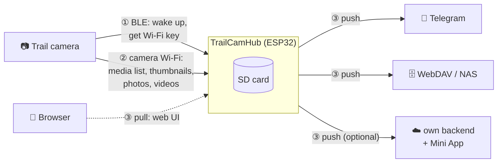
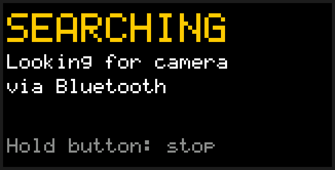
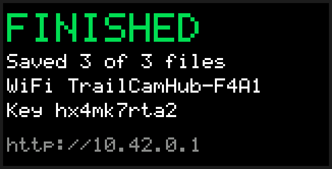

# TrailCamHub

<!-- Badge data that GitHub does not expose comes from .github/workflows/badges.yml. -->

 

**Get the pictures off your trail camera without walking to it.** TrailCamHub
is open-source firmware for a small ESP32 board that sits near a Wi-Fi trail
camera, wakes it over Bluetooth, copies new pictures to an SD card and sends
them on: to your phone via Telegram, to a NAS, or over 4G from places without
any Wi-Fi.

> [!NOTE]
> **Early stage, hobby project.** The full chain runs on the bench with a
> TC100 camera; many newer features are built and tested in CI but still
> await hardware tests ([open issues](https://github.com/ThomasPohl/TrailCamHub/issues)).
> TrailCamHub is independent and not affiliated with the TrailCam Go app, its
> provider or any camera manufacturer. Use it only with a camera you own.

## How it works

1. **Wake** — the camera sleeps with Wi-Fi off. The hub finds it over BLE and
   asks it to switch its Wi-Fi access point on.
2. **Read** — the hub joins that access point and talks the camera's own
   protocol (the one the TrailCam Go app uses): device info, battery, SD state,
   the media list and the thumbnails, and on request photos and videos.
   Everything lands on the hub's SD card.
3. **Deliver** — over the home Wi-Fi, Ethernet or a 4G modem the hub pushes
   new pictures to a destination, or serves them from its own web page.

This runs on a schedule (for example every two hours, more often at dawn) with
deep sleep in between, or on request from a button, the web page or a chat
command.

  
  
  
   Status on boards with a display (LilyGO T-Dongle)

## Quick start

1. **Get a board** — one of the [supported boards](#supported-hardware), plus a
   microSD card (FAT32) and a USB data cable.
2. **Flash it in the browser** — open the
   **[web installer](https://thomaspohl.github.io/TrailCamHub/)** in Chrome or
   Edge on a desktop, pick your board and click *Install*. No toolchain needed.
3. **Answer three questions** — where the hub runs (mains or battery), how you
   want the pictures (pushed to you or fetched from the hub) and how it gets
   online. The installer offers only what your board can do and stores the
   settings on the hub over USB.
4. **Check it** — the installer tests the SD card and runs a first camera
   search. Put the hub within Bluetooth and Wi-Fi range of the camera
   (a few metres to some tens of metres).

Details: [web installer and console](docs/installer.md) ·
[modes and destinations](docs/modes.md).

## Supported hardware

| Board | Good for | Highlights |
|---|---|---|
| **Waveshare ESP32-S3-A7670E-4G** | remote spots, battery + solar | 4G modem, battery gauge, PSRAM |
| **LilyGO T-Dongle-C5** | at home, USB power | display + button, web UI, PSRAM |
| **LilyGO T-Dongle-S3** | at home, USB power | display + button, no PSRAM (thumbnails) |
| **Waveshare ESP32-P4-NANO** | at home, wired | Ethernet, web UI, PSRAM |
| **Waveshare ESP32-S3-ETH** | at home, wired / PoE | Ethernet (W5500), web UI, PSRAM |
| **ESP32-WROOM-32D + SPI microSD** | cheapest start | thumbnails only, mains power |

Capabilities, presets and wiring per board: [hardware](docs/hardware.md) and
[modes](docs/modes.md). The list of boards lives in [`boards.json`](boards.json).

**Cameras:** tested with a **TC100**. Cameras that work with the TrailCam Go app
and speak the same protocol (Wi-Fi name `TrailCam_XXXX`, BLE name `TC100_…`)
are likely to work but are not tested yet — reports are welcome.

## Where the pictures go

| You have … | Push (hub sends) | Pull (you fetch) |
|---|---|---|
| **no Wi-Fi at the camera** (4G modem) | **Telegram** bot, optionally your own backend | — |
| **home Wi-Fi or Ethernet** | **WebDAV** (Nextcloud, Synology, …), optionally your own backend | **web UI** on the hub |
| **nothing** (hub's own access point) | — | **web UI** on the hub |

No shared cloud and no running costs: every user either needs no server or
runs their own. The optional AWS backend with a Telegram Mini App is in
[`backend/`](backend/README.md) and [`app/`](app/README.md).

## Documentation

| Topic | |
|---|---|
| [Hardware](docs/hardware.md) | boards, main board details, open hardware questions |
| [Modes](docs/modes.md) | power, push/pull, transport, destinations; per-board notes |
| [Power and schedule](docs/power-and-schedule.md) | camera read plan, check-ins, deep sleep |
| [Web installer and console](docs/installer.md) | flashing, setup assistant, serial commands |
| [Architecture](docs/architecture.md) · [files on the SD card](docs/sd-layout.md) · [decisions](docs/decisions.md) | components, tasks, memory, session state machine; catalog and file formats; why things are the way they are |
| [Development](docs/development.md) | build, profiles, host tests, dev container, CI, camera mock |
| [UDP protocol](docs/udp-protocol.md) · [protocol analysis](docs/protocol-analysis.md) | how the camera talks |
| [Video download](docs/video-download.md) · [OTA updates](docs/ota.md) · [4G modem](docs/modem.md) | single features |
| [Roadmap](docs/roadmap.md) | goals, milestones, ideas for easier setup |

## Contributing

Contributions are welcome — especially reports about **camera models** and
**boards** that work or do not, with logs. Open an
[issue](https://github.com/ThomasPohl/TrailCamHub/issues) first for larger
changes; how to build and test is in [development](docs/development.md). Do
not submit private media, credentials or firmware images obtained without
authorization.

## License

Apache License 2.0, see [LICENSE](LICENSE).
