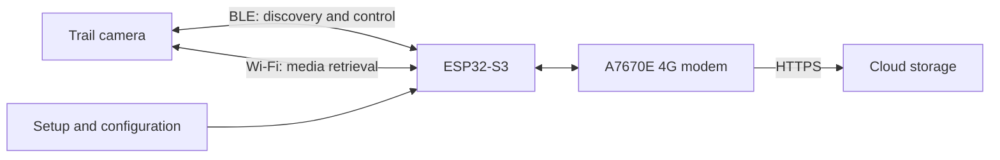
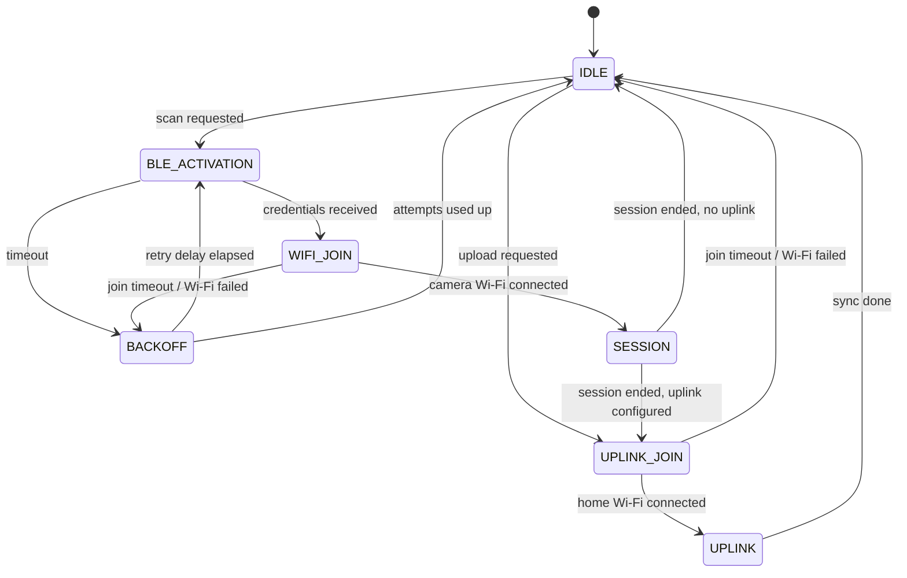

# TrailCamHub

<!-- Badge data that GitHub does not expose comes from .github/workflows/badges.yml. -->
[](https://github.com/ThomasPohl/TrailCamHub/actions/workflows/firmware-package.yml?query=branch%3Amain)
[](https://github.com/ThomasPohl/TrailCamHub/actions/workflows/app.yml?query=branch%3Amain)
[](https://github.com/ThomasPohl/TrailCamHub/actions/workflows/backend.yml?query=branch%3Amain)
[](test/host)
[](partitions.csv)
[](docs/modes.md)

[](https://github.com/ThomasPohl/TrailCamHub/releases/latest)
[](https://github.com/ThomasPohl/TrailCamHub/releases/latest)
[](https://thomaspohl.github.io/TrailCamHub/)
[](LICENSE)
[](https://github.com/ThomasPohl/TrailCamHub/commits/main)
[](https://github.com/ThomasPohl/TrailCamHub/pulse)

[](docs/ota.md)
[](https://github.com/ThomasPohl/TrailCamHub/releases)
[](https://github.com/ThomasPohl/TrailCamHub/stargazers)
[](https://github.com/ThomasPohl/TrailCamHub/forks)

An open-source trail camera bridge: an ESP32-S3 with an A7670E 4G modem is intended to retrieve media from supported trail cameras and transfer it to a configurable cloud storage service.

> **Status:** Concept / early draft. Hardware support, camera compatibility, wireless interoperability, and cloud integration have not yet been verified.

TrailCamHub aims to reproduce and automate the workflow of the **Trailcam Go** app for compatible cameras. The goal is interoperability with a camera owned by the user, not copying or distributing the proprietary app. TrailCamHub is an independent project and is not affiliated with Trailcam Go, its provider, or any camera manufacturer.

## Goals

1. Discover a camera in range and identify its available media.
2. Exchange control and connection information over Bluetooth Low Energy (BLE), where supported by the camera model.
3. Connect to the camera over Wi-Fi and download new photos and videos.
4. Buffer files locally and persist their upload status.
5. Transfer files to cloud storage over 4G using the A7670E modem.
6. Resume reliably after interruptions without losing files or creating unnecessary duplicate uploads.

## Proposed Architecture



The wireless links have different roles: BLE is expected to handle discovery and control, while Wi-Fi is intended for media retrieval. The cellular modem provides a separate internet uplink. Whether a specific camera follows this workflow depends on its model and firmware and must be verified first.

## Architecture Approach

The firmware should be divided into clearly separated components:

- **Camera discovery:** BLE scanning, supported-model identification, and connection status.
- **Camera adapter:** model-specific flows for authentication, Wi-Fi connection, file listing, and downloads. Shared functionality should remain separate from vendor-specific behavior.
- **Transfer queue:** a persistent list of discovered files with checksums, sizes, timestamps, and upload status.
- **Network manager:** manages the camera Wi-Fi connection and cellular uplink. Switching between these networks must not lose download or upload state.
- **Cloud adapter:** interchangeable upload destinations, initially over HTTPS. Credentials and endpoints should be configured rather than hard-coded in firmware.
- **Configuration and diagnostics:** secure setup of camera and cloud credentials, status reporting, and actionable error codes.

The firmware platform for the initial BLE proof of concept is ESP-IDF. The cloud destination will be selected after the board, modem interface, and initial camera protocols have been evaluated.

## Hardware and Open Questions

The target board is the **Waveshare ESP32-S3-A7670E-4G** development board. According to the [Waveshare documentation](https://docs.waveshare.com/ESP32-S3-A7670E-4G) it provides:

- ESP32-S3R8 with 512 KB internal SRAM, 8 MB in-package octal PSRAM, and 16 MB external flash
- A7670E LTE Cat-1/2G modem connected to the **native USB port of the ESP32-S3** (USB host, PPP), not to a UART. Because the ESP32-S3 has a single USB PHY, the firmware console uses UART0 through the board's USB-to-UART bridge. The bridge and the modem's USB share one USB-C port; DIP switches select which one is connected.
- microSD (TF) slot, wired to the SDMMC peripheral in 1-bit mode (CLK GPIO5, CMD GPIO4, D0 GPIO6, per the Waveshare Arduino examples)
- 18650 battery holder, solar charging input, and a MAX17048 battery fuel gauge on I2C
- DIP switches for camera, USB hub, and modem power; GNSS antenna connector; 24-pin camera connector

The firmware configuration (`sdkconfig.defaults`, `partitions.csv`) targets this board: 16 MB flash, octal PSRAM, two 4 MB OTA application slots, a 64 KB core dump partition, and 64 KB NVS. Camera media is intended to be buffered on the SD card. Board revisions V1 and V2 differ in some GPIO assignments (camera and I2C); the SD card pins can be changed in `menuconfig` if a revision differs. Still to verify:

- Board revision and modem power-control GPIO (the USB host/PPP uplink is implemented, see [docs/modem.md](docs/modem.md), but not yet tested on hardware)
- Power supply and cellular modem peak current requirements on battery
- Supported LTE bands, SIM format, and antenna connections for the deployment location
- ESP32-S3 BLE and Wi-Fi capabilities during simultaneous operation

A camera and a cellular subscription are required for testing. Camera credentials and SIM PINs must not be committed to the repository.

## Compatibility and Protocol Investigation

Compatibility with cameras supported by Trailcam Go is a development goal, not a confirmed feature. First, investigate the normal connection flow and data formats for a specific camera model owned by the project team. Then implement a focused camera adapter and verify it using test media.

Protocol observations should be documented reproducibly without publishing credentials, private images, or personal data. TrailCamHub must not bypass security mechanisms. Verify compatibility, authorization, and applicable terms of use before testing.

### BLE Wi-Fi Activation PoC

The firmware scans in 30-second windows for a connectable advertisement whose name starts with `TC100_` or that advertises service UUID `0x8801`, and connects to the first match that was not read in this scan yet; unrelated nearby devices are not connected. After a camera is done, the scan looks for further cameras the same way (see [docs/power-and-schedule.md](docs/power-and-schedule.md#several-cameras-per-scan)). Non-connectable advertisements are ignored. After connecting, the firmware logs the camera's complete GATT profile. The compatibility check requires service `0x8801` to include writable characteristic `0x0002` and notification/indication characteristic `0x0003` before the Wi-Fi-enable command is sent. Candidate filtering is only a fast pre-filter, not proof of compatibility. Scan and connection callbacks are serialized so failed connections do not trigger overlapping scans. These UUIDs were first reported for a Lutranstra PR5000-WF and have been confirmed with a TC100 camera.

The BLE implementation lives in the `camera_ble` component and uses the NimBLE host as a central/GATT client only (no pairing, one connection). `camera_ble.cpp` owns the NimBLE stack lifecycle, scanning, the connection and the GATT client sequence (services → characteristics → CCCD → Wi-Fi-enable write), `camera_ble_discovery.cpp` filters advertisements, and `camera_ble_protocol.cpp` parses the configured command and framed JSON responses and reports the credentials through a callback. The hardware-independent parts (`ble_advertising.cpp`, `ble_wifi_response.cpp`, `gatt_profile.cpp`, `hex_payload.cpp`) are covered by host tests. The NimBLE stack and the Bluetooth controller are only started while the camera is being activated. With **Release BLE after the camera Wi-Fi was activated** (enabled by default) the firmware disconnects from the camera and shuts BLE down once the credentials have arrived, which returns the stack's memory for the camera session; disable the option if a camera switches off its access point when the BLE connection ends. Camera names and advertised service UUIDs can be extended in the discovery module as additional models are investigated.

The default Wi-Fi-enable payload is ASCII `BT_KEY_ON` (`42 54 5F 4B 45 59 5F 4F 4E` in hex), based on the reported BLE command for enabling the camera's Wi-Fi. The firmware writes it to characteristic `0x0002` after discovering the configured service and characteristic. The UUIDs still need to be independently verified for the TC100.

The serial log also reports the camera's BLE address, address type, signal strength (RSSI), advertisement and scan-response bytes, discovered services and characteristics, and the properties and handles of those characteristics. For characteristics that support notifications or indications, the firmware subscribes. It reassembles the framed JSON response from characteristic `0x0003` and prints the response status, SSID, and BSSID. The Wi-Fi password is deliberately redacted; BLE packet contents for this response are not logged in hex because they contain credentials.

The Wi-Fi name cannot currently be predicted reliably from a BLE device name. A camera may derive an SSID suffix from an address or another device identifier, but that mapping has not been verified. Compare the SSID (for example, `TrailCam_897B`) with the BLE address and captured advertisement data from the serial log before assuming there is a stable relationship; BLE addresses may also be randomized.

### Camera Wi-Fi PoC

The camera Wi-Fi code is split into two components: `camera_wifi` manages the station lifecycle and reports Wi-Fi events, and `camera_link` implements the camera session. In `camera_link`, `pppp_session.cpp` is the reliable-UDP layer (DATA numbering, retransmission of unacknowledged DATA every 800 ms, acknowledgement and duplicate filtering of received DATA, ALIVE answers, CLOSE detection), `camera_protocol.cpp` implements discovery, PRE_LOGIN, and the ARTEMIS Hello and heartbeats on top of it, `camera_prelogin.cpp` builds the PRE_LOGIN plaintext, `camera_udp_packets.cpp` defines a shared `UdpRequest` interface and fixed-size request types for discovery, PRE_LOGIN, ARTEMIS commands, RUDP DATA/ACK, and handshake Magic packets, while `camera_udp_transport.cpp` owns UDP send/receive and packet-level TX/RX logs. `ArtemisCommandRequest` builds the ARTEMIS request header around an already encrypted and Base64-encoded payload; command-specific JSON, encryption, and commands such as login and file listing are not implemented yet. Packet framing follows the PPPP/CS2 P2P protocol: reliable DATA packets (`F1 D0`) carry a 16-bit index per channel, numbered consecutively from 0 in each session, and ACKs (`F1 D1`) list the acknowledged indices (`D1 00 <count:2> <index:2>...`), the same format the camera uses.

After a successful BLE Wi-Fi response, the firmware uses the returned SSID and password to join the camera access point. Credentials are kept in runtime memory only and are not logged or saved to NVS. Once connected, it binds its UDP socket to local port `35281` and sends the `LBCS` discovery packet to the Wi-Fi gateway on ports `40611` and `3333`. For up to 1.5 seconds it waits for a packet longer than four bytes, prefixed with `F1`, from that gateway; the reply's source port is then used for the AES-128-ECB/PKCS#7 encrypted `F9` PRE_LOGIN request containing the current Unix timestamp and a fresh 8-byte nonce. Queued discovery traffic is drained before PRE_LOGIN. After sending PRE_LOGIN, the firmware waits up to one second for an ARTEMIS `F1 D0` DATA packet from the camera, validates its RUDP header and declared length, and acknowledges its index. It then sends the ARTEMIS Hello (DATA index 0) and the two Magic handshake packets from the reference implementation, whose purpose is not yet understood. The camera's ALIVE packets (`F1 E0 00 00`, about every 1.1 seconds) are answered with ALIVE_ACK (`F1 E1 00 00`); without them the camera ends the session with CLOSE (`F1 F0 00 00`) after a few seconds, which the firmware logs before ending the session. The RUDP session sends heartbeat DATA packets every 1.5 seconds, waits for a matching ACK before sending the next heartbeat, and retransmits the current heartbeat with the same index after 800 ms if no matching ACK arrives. Valid DATA packets from the camera are acknowledged immediately. DATA payloads are not decrypted or processed; application login and file retrieval are not implemented. The 28-byte static header, key, request layout, handshake payloads, heartbeat contents, and RUDP DATA/ACK framing follow the experimental [pi_trailcam reference implementation](https://github.com/philibertschlutzki/pi_trailcam/blob/main/main.py); discovery, PRE_LOGIN, heartbeats, and ALIVE/CLOSE have been observed with a TC100 camera. The device clock must be set for the timestamp to be meaningful; firmware currently warns if it appears unset. Serial diagnostics include discovery target, UDP ports, complete hex data for outgoing and received UDP packets, elapsed time, and DATA/ACK indices; Wi-Fi disconnect reasons, RSSI, and BSSID are logged as well. Credentials are never logged.

The firmware uses the custom partition table in `partitions.csv` (16 MB flash, two 4 MB OTA slots, core dump partition). OTA update logic itself is not implemented yet. At boot the firmware logs the reset reason, the available PSRAM, whether a core dump from a previous crash is stored (read it with `idf.py coredump-info`), and mounts the SD card at `/sdcard` without ever formatting it; a missing card is not fatal. Free and minimum-ever free heap for internal RAM and PSRAM are logged at boot, after Wi-Fi and BLE start, when the camera Wi-Fi connects, and every 30 seconds (**Memory log interval** in `menuconfig`; 0 disables the periodic log).

Build and flash with ESP-IDF:

```sh
idf.py set-target esp32s3
idf.py menuconfig
idf.py build flash monitor
```

#### Project structure

The firmware is split into ESP-IDF components with explicit dependencies:

| Component | Responsibility |
|---|---|
| `main` | `app_main`: initializes storage and radios and wires the components together |
| `components/camera_ble` | BLE scan and connection, GATT profile check, Wi-Fi-enable command, credential response |
| `components/camera_wifi` | Wi-Fi station for the camera access point; runs a session callback after each connection |
| `components/camera_link` | Camera session over UDP: discovery, PRE_LOGIN, PPPP/ARTEMIS packets, ALIVE, heartbeats |
| `components/sd_storage` | microSD card mount |
| `components/diagnostics` | Reset reason, core dump status, and heap statistics |
| `components/schedule`, `schedule_state`, `scheduler` | Wake-up schedule: camera read plan and check-in times (pure logic, host-tested), state across deep sleep and settings from the backend, the task that requests the cycles and sleeps in between |
| `components/session_controller` | Session state machine and the tasks that drive a scan: camera session, then backend uplink; request and status interface for front ends |
| `components/hub_config` | Hub settings in NVS (home Wi-Fi, backend URL, device key) with validation |
| `components/hub_console` | Line-based serial commands (`scan`, `camlist`, `upload`, `stop`, `config …`) used by the web installer |
| `components/uplink` | HTTPS sync with the backend: check-in, thumbnail upload, acknowledgement |

Components do not call each other directly. They report events through callbacks to the session controller, which runs them in one task:



A stop request ends the cycle early from any state except `UPLINK`: waking the camera, joining a Wi-Fi network and the retry delay are left at once; a running camera session is closed cleanly first; the backend sync is skipped. A sync that is already running finishes.

The controller does not know which front end drives it. Front ends request cycles with `session_controller_request_scan()`, `…_request_upload()` and `…_request_stop()`, and follow the progress through status listeners (`session_controller_add_status_listener()`) or by polling `session_controller_get_status()`: phase, attempt, retry delay, camera SSID and the result of the last cycle. The camera SSID and the result stay set after a cycle ends until the next one starts, so a front end can keep showing them. The serial console is one such front end; the display, the local web UI and the scheduler use the same interface.

The hub no longer retries forever. A scan is requested over the serial console (for example with **Scan camera now** in the web installer), the button or the web UI, by a command from the app, or by the **scheduler** on the camera read plan (see below). A scan wakes the camera over BLE, joins its Wi-Fi and runs the camera session (device info, media list, thumbnails to the SD card). If the camera is not reached, the scan is retried a few times (3 attempts, 10 seconds apart by default) and then given up. After the camera session, and if the uplink settings are complete, the hub joins the home Wi-Fi and syncs with the backend (see [`backend/README.md`](backend/README.md)): one check-in covers every camera stored on the SD card (battery and SD state, and only the recordings the backend does not know yet), then the hub uploads the thumbnails the backend asks for and acknowledges them in one request; the backend's time also sets the hub's clock. Each camera keeps its data in `/sdcard/<camera-id>/` (`camera.json`, `catalog.csv`, `thumb/`), and cameras appear in the backend automatically the first time a hub reports them. **Upload stored data only** runs just that sync.

BLE activation is paused while joining the camera Wi-Fi and during the session, and credentials that arrive later are ignored; by default the BLE stack is released at that point (see the BLE section). Timeouts, attempts and the retry delay are configurable in `menuconfig` under **TrailCamHub PoC → Session**.

**Mode and schedule.** The board fixes the hardware; how the hub is used is a **mode** chosen at run time (`config set power mains|battery`, `config set direction push|pull`, also in the web installer; see [`docs/modes.md`](docs/modes.md)). Empty settings take the board's preset: *battery + push* on the ESP32-S3-A7670E-4G reads the camera on a plan of time windows (`*=120`: every two hours), checks in with the backend every 30 minutes and sleeps (deep sleep) in between; *mains + pull* on the T-Dongles and the P4 stays awake and only scans on request. The plan and the check-in interval can be set on the hub (`config set camera_plan 05:00-09:00=30,*=120`, `config set checkin_min 15`, also in the web installer) and per hub in the app, which takes precedence. `status` shows the schedule and the next planned read and check-in. Details, including what survives deep sleep and how to wake a sleeping hub, are in [`docs/power-and-schedule.md`](docs/power-and-schedule.md). The pure state machine (`session_fsm.cpp`), the command parser and the uplink wire format are covered by host tests. Project options are defined in `main/Kconfig.projbuild` and appear in `menuconfig` under **TrailCamHub PoC**.

#### Serial commands

The console UART accepts one command per line; replies and progress are lines starting with `TCH`:

| Command | Effect |
|---|---|
| `status` | Current state, settings (secrets hidden) and schedule (next camera read and check-in) |
| `scan` | Read the camera, then sync with the backend if configured |
| `camlist` | List all media on the camera, one `TCH EVENT media type=… dir=… num=… id=… time=…` line per file, ending with `TCH EVENT list done files=… pages=…`. Wakes the camera but fetches and syncs nothing, leaves the catalog alone and does not count as a read for the schedule |
| `upload` | Sync the data already on the SD card with the backend |
| `stop` | End the running scan; a running backend sync finishes |
| `config show` | List settings |
| `config set <key> <value>` / `config set-hex <key> <hex>` | Store a setting (all keys: `help`; modes and destinations: [`docs/modes.md`](docs/modes.md)) |
| `config unset <key>` / `config clear` | Erase one or all settings |

The settings live in NVS on the hub. The web installer's **Device setup** panel uses exactly these commands.

#### Host tests

Protocol parsing and packet construction do not depend on ESP-IDF and are unit-tested on the development machine with [doctest](https://github.com/doctest/doctest), including packets captured from a TC100 camera. No board or ESP-IDF installation is required:

```sh
cmake -S test/host -B build-host
cmake --build build-host
ctest --test-dir build-host --output-on-failure
```

Code in these hardware-independent files must not include ESP-IDF headers. New parsing or protocol logic should be placed in such files and covered by a test in `test/host`.

#### Build profiles

The firmware has two build profiles:

- **Development** (default): `idf.py build` uses only `sdkconfig.defaults`. It keeps ESP-IDF's debug-friendly optimization level and INFO logging, including the complete camera UDP packet contents. This is the profile flashed by the browser installer.
- **Release**: adds `sdkconfig.defaults.release`, which optimizes for size, silences assertion messages, and removes INFO/DEBUG log statements and Bluetooth stack logs at compile time. Use it to judge the binary size and RAM headroom of the firmware.

Build the release profile in its own build directory so it does not disturb the incremental development build:

```sh
idf.py -B build-release -D IDF_TARGET=esp32s3 \
    -D SDKCONFIG=build-release/sdkconfig \
    -D SDKCONFIG_DEFAULTS="sdkconfig.defaults;sdkconfig.defaults.release" \
    build size
```

The VS Code task **ESP-IDF: Build release firmware and show size** runs the same command. Profile-independent settings belong in `sdkconfig.defaults`; size-related settings that hinder debugging belong in `sdkconfig.defaults.release`.

#### GitHub Codespaces build environment

The repository's [Dev Container configuration](./.devcontainer/devcontainer.json) builds on the same `espressif/idf:v5.5.6` image as the firmware CI workflow ([`.devcontainer/Dockerfile`](./.devcontainer/Dockerfile)), sets `IDF_PATH` to `/opt/esp/idf`, and mounts the repository at `/project`. It adds the tools of the other CI checks: clang-format 23.1.3, Node 22 for `app/` and `backend/`, and the GitHub CLI. Every shell has ESP-IDF set up (`idf.py`, `cmake`), ccache is on, and `/root/.cache` (ccache, component and pip caches) is a volume that survives rebuilds. To flash and monitor boards on USB from the container, use the second configuration in [`.devcontainer/hardware/`](./.devcontainer/hardware/README.md). Keeping this mount point stable is important: CMake records absolute source and build paths in `build/CMakeCache.txt`. If a Codespace previously built the project from another path, the existing cache can no longer be used from that different path.

To apply the Dev Container configuration to an existing Codespace, run **Codespaces: Rebuild Container** from the VS Code Command Palette (`Ctrl+Shift+P` / `Cmd+Shift+P`). If that command is not available, use **Dev Containers: Rebuild Container**. This rebuilds the Codespace container; it does not delete the repository's `build/` directory. After reconnecting, verify the environment from the integrated terminal:

```sh
printf 'IDF_PATH=%s\n' "$IDF_PATH"
idf.py --version
```

`IDF_PATH` should be `/opt/esp/idf`, and the ESP-IDF version should be 5.5.6. Build the firmware with the default VS Code build task **ESP-IDF: Build firmware** (`Ctrl+Shift+B`) or run this command from the repository root:

```sh
idf.py build
```

For a fresh checkout, select the target once before the first build:

```sh
idf.py set-target esp32s3
```

The `build/` directory is intentionally ignored by Git and should be kept between builds for incremental compilation. The generated `sdkconfig` is also local and ignored; project defaults belong in the tracked `sdkconfig.defaults`. Do not routinely delete `build/` or run `idf.py fullclean`. The stable `/project` mount avoids cache path mismatches across Codespace restarts/rebuilds. If the ESP-IDF image/version or target changes, follow ESP-IDF's documented reconfiguration process for that change rather than clearing the build directory as a routine step.

In `menuconfig`, open **TrailCamHub PoC**. **Wi-Fi enable payload (hex)** defaults to the bytes for ASCII `BT_KEY_ON`; spaces, colons, and hyphens may separate hex bytes. Set the option to an empty string to inspect GATT profiles without writing. The PoC uses a GATT write with response when supported by the characteristic. **Log camera UDP packet contents as hex** (enabled by default) logs every sent and received camera UDP packet in 16-byte hex lines below its one-line summary; disable it to reduce serial output.

The **Firmware Package** GitHub Actions workflow builds the ESP32-S3 firmware and publishes a `trailcamhub-esp32s3` artifact containing a merged flash image, the individual firmware images, checksums, and deployment instructions. The default CI build uses the development profile, includes the `BT_KEY_ON` Wi-Fi-enable payload, and sends it after GATT discovery. The workflow also builds the release profile and writes a size report to the run summary: total image size, free space in the application partition, and memory use per component. On pull requests it adds a size comparison against the target branch and warns when less than 10 % of the application partition remains free. Separate jobs run the host unit tests and check C/C++ formatting with `clang-format` 23 against the repository's `.clang-format`; run `git ls-files '*.cpp' '*.h' '*.hpp' | xargs clang-format -i` before committing.

### Browser Installer and Serial Console

The GitHub Pages site provides a browser-based firmware installer and serial console:

**https://thomaspohl.github.io/TrailCamHub/**

The installer uses [ESP Web Tools](https://esphome.github.io/esp-web-tools/) to flash the merged ESP32-S3 image. The image and manifest are published together on GitHub Pages by the **Firmware Package** workflow after a push to `main`. Pull requests build the deployment package but do not publish the site. The installer reflects the latest successful deployment from `main`; it is not a version-pinned release installer. To enable the deployment the first time, open the repository's **Settings → Pages** and select **GitHub Actions** as the build and deployment source. The workflow then publishes the page automatically.

The page opens with a **setup assistant**: choose the board (from [`boards.json`](boards.json)), install the release build, connect, answer three questions (where the hub runs, how you want to get the pictures, how it gets online; only the options the board can do are offered), save, and check the hub (firmware, SD card, battery, settings, then a first camera search with the upload). Everything else — older and development builds, every single setting, the live protocol view, the serial console, a reset over the serial lines, a command line and a **support package** (status, settings without secrets, the newest log file from the SD card and the page's serial log as one text file) — is under **Advanced**.

Use a desktop Chromium-based browser with Web Serial support, such as current Google Chrome or Microsoft Edge. Open the HTTPS installer page, connect the ESP32-S3 using a USB data cable, select its serial port, and confirm the browser's install prompt. Close or finish the installer before opening the serial console; then click **Connect to serial output**, choose the board's port, and view ESP-IDF logs at 115200 baud. Browser serial access requires explicit permission and may not be available in other browsers or on mobile devices.

The manual merged image and its SHA-256 checksum are also available on the installer page. Alternatively, download the `trailcamhub-esp32s3` artifact from a successful GitHub Actions run and follow its deployment instructions.

After installing, the **Device setup** panel connects to the hub over the same USB serial port. It stores the home Wi-Fi, backend URL and device key on the hub (passwords and keys are written only, never read back), and has buttons to start a scan or an upload-only sync and to watch their progress.

The installer does not configure the camera name or Wi-Fi-enable payload. It installs the default CI build, which sends `BT_KEY_ON` to request Wi-Fi activation after BLE discovery. Do not install firmware unless you trust its source, and use the installer only with a board you are authorized to modify.

### Phone App (Telegram Mini App)

The phone UI lives in [`app/`](app/README.md): a React web app that runs as a Telegram Mini App and is published on the same GitHub Pages site under **https://thomaspohl.github.io/TrailCamHub/app/**. It shows camera status and thumbnails and lets users request video downloads. Until the backend exists it runs in demo mode with sample data. The **App** workflow lints, tests and builds it on pull requests.

## Reliability and Security

- Mark files as locally available only after a successful download and a reasonable integrity check.
- Make uploads idempotent and resumable after power or network failures.
- Store credentials securely on-device and never include them in logs.
- Encrypt cloud connections and validate certificates correctly.
- Bound storage usage and define when successfully transferred files may be deleted locally.
- Make errors and diagnostics useful for maintaining a device without a display.

## Development Milestones

1. Verify the board revision, pinout, power supply, and modem interface.
2. Select a supported camera and document its BLE/Wi-Fi workflow using test data.
3. Verify the BLE-controlled camera Wi-Fi connection and initial API requests on a supported camera.
4. Enable a single media download with an integrity check.
5. Add a persistent queue and resumable uploads.
6. Connect an initial HTTPS cloud adapter and run end-to-end tests.
7. Expand setup, diagnostics, camera support, and security features.

## Roadmap: adoption and setup simplification

The firmware flow is coming together; the larger open question is how hard this is
for someone else to actually deploy. Flashing is already easy (the web installer),
but the surrounding steps are still "advanced hobbyist". These are the planned
improvements, roughly in order of how much they lower the barrier:

- **Runtime configuration instead of recompiling (highest impact).** Provision the
  device without a toolchain: a first-boot Wi-Fi access point ("TrailCamHub-Setup")
  with a small config page (cellular APN, cloud/relay URL + secret, wake interval,
  camera selection), or — even better — write the same config over Web Serial
  directly from the existing web installer, so "flash + configure" is one browser
  flow. One binary then serves every user.
- **Camera compatibility is the first gate.** Only cameras from the supported
  (ARTEMIS/PPPP) family work. Publish a **compatibility matrix** and add a
  **"does my camera work?" diagnostic mode** as the very first step, so an
  incompatible camera is surfaced up front rather than as a late frustration.
- **Cloud relay as a copy-paste template.** Prefer a small relay (e.g. a Google
  Apps Script web app: one HTTPS POST → Drive folder + Sheet row, plus a
  command endpoint for the downlink) over putting Google OAuth/keys on the device.
  Ship it as a copy-paste template with screenshots for users; keep `clasp` as the
  developer path. Secrets live in Script Properties, never in the repo.
- **Sane defaults and modes.** Ship a "thumbnails + metadata only" default (cheap,
  winter-friendly), with full photo/video transfer opt-in, so a newcomer has to
  decide almost nothing.
- **Quickstart with a bill of materials and a wiring diagram.** A concrete parts
  list and a wiring picture remove most of the hardware uncertainty.
- **Downlink by polling on wake.** Since the device sleeps, a return channel works
  as a command queue the device reads on each wake (e.g. "fetch full video X",
  "change interval", OTA), rather than a persistent connection.

Realistic target: with runtime config, a copy-paste cloud template, and a
compatibility list, end-to-end setup moves from "1–3 h for a tinkerer" toward
"~30 min for a technically-minded user", with the genuinely hard constraints
(camera compatibility, cellular SIM) made visible up front.

## Contributing

Contributions are welcome. During this early phase, verified information about board revisions, camera models, and reproducible connection steps is especially useful. Do not submit private media, credentials, or firmware images obtained without authorization.

## License

This project is licensed under the Apache License 2.0. See [LICENSE](LICENSE).
