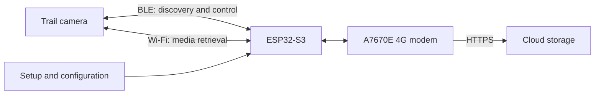

# TrailCamHub

An open-source trail camera bridge: an ESP32-S3 with an A7670E 4G modem is intended to retrieve media from supported trail cameras and transfer it to a configurable cloud storage service.

> **Status:** Concept / early draft. Hardware support, camera compatibility, wireless interoperability, and cloud integration have not yet been verified.

TrailCamHub aims to reproduce and automate the workflow of the **Trailcam Go** app for compatible cameras. The goal is interoperability with a camera owned by the user, not copying or distributing the proprietary app. TrailCamHub is an independent project and is not affiliated with Trailcam Go, its provider, or any camera manufacturer.

## Goals

1. Discover a camera in range and identify its available media.
2. Exchange control and connection information over Bluetooth Low Energy (BLE), where supported by the camera model.
3. Connect to the camera over Wi-Fi and download new photos and videos.
4. Buffer files locally and persist their upload status.
5. Transfer files to cloud storage over 4G using the A7670E modem.
6. Resume reliably after interruptions without losing files or creating unnecessary duplicate uploads.

## Proposed Architecture



The wireless links have different roles: BLE is expected to handle discovery and control, while Wi-Fi is intended for media retrieval. The cellular modem provides a separate internet uplink. Whether a specific camera follows this workflow depends on its model and firmware and must be verified first.

## Architecture Approach

The firmware should be divided into clearly separated components:

- **Camera discovery:** BLE scanning, supported-model identification, and connection status.
- **Camera adapter:** model-specific flows for authentication, Wi-Fi connection, file listing, and downloads. Shared functionality should remain separate from vendor-specific behavior.
- **Transfer queue:** a persistent list of discovered files with checksums, sizes, timestamps, and upload status.
- **Network manager:** manages the camera Wi-Fi connection and cellular uplink. Switching between these networks must not lose download or upload state.
- **Cloud adapter:** interchangeable upload destinations, initially over HTTPS. Credentials and endpoints should be configured rather than hard-coded in firmware.
- **Configuration and diagnostics:** secure setup of camera and cloud credentials, status reporting, and actionable error codes.

The firmware platform for the initial BLE proof of concept is ESP-IDF. The cloud destination will be selected after the board, modem interface, and initial camera protocols have been evaluated.

## Hardware and Open Questions

The planned hardware is a board with an **ESP32-S3 and A7670E 4G modem**, identified as `ESP32-S3-A76703-4G-EN`. Before implementation, verify the exact board revision and, in particular:

- Pinout and ESP32-S3-to-modem interface, typically UART
- Power supply and cellular modem peak current requirements
- Supported LTE bands, SIM format, and antenna connections for the deployment location
- ESP32-S3 BLE and Wi-Fi capabilities during simultaneous operation
- Storage capacity for a robust local upload queue

A camera and a cellular subscription are required for testing. Camera credentials and SIM PINs must not be committed to the repository.

## Compatibility and Protocol Investigation

Compatibility with cameras supported by Trailcam Go is a development goal, not a confirmed feature. First, investigate the normal connection flow and data formats for a specific camera model owned by the project team. Then implement a focused camera adapter and verify it using test media.

Protocol observations should be documented reproducibly without publishing credentials, private images, or personal data. TrailCamHub must not bypass security mechanisms. Verify compatibility, authorization, and applicable terms of use before testing.

### BLE Wi-Fi Activation PoC

For the PoC, firmware scans for 30 seconds and queues up to 16 connectable advertisements that match a known camera name or advertise service UUID `0x8801`. It connects to those candidates in turn and checks their GATT profile; unrelated nearby devices are not connected or surveyed. The current name allowlist contains `TC100_ED3B`. Non-connectable advertisements cannot be inspected over GATT. The final compatibility check requires service `0x8801` to include writable characteristic `0x0002` and notification/indication characteristic `0x0003` before the Wi-Fi-enable command is sent. Candidate filtering is only a fast pre-filter, not proof of compatibility. Scan and connection callbacks are serialized so failed connections do not trigger overlapping scans. These UUIDs were reported for a Lutranstra PR5000-WF but have not yet been independently verified for the TC100.

The BLE implementation is separated by responsibility: `camera_ble.cpp` owns scan/connection state and GAP/GATT callbacks, `camera_ble_discovery.cpp` filters advertisements, `camera_ble_profile.cpp` discovers and validates GATT services and characteristics, and `camera_ble_protocol.cpp` parses the configured command and framed JSON responses. Camera names and advertised service UUIDs can be extended in the discovery module as additional models are investigated.

The default Wi-Fi-enable payload is ASCII `BT_KEY_ON` (`42 54 5F 4B 45 59 5F 4F 4E` in hex), based on the reported BLE command for enabling the camera's Wi-Fi. The firmware writes it to characteristic `0x0002` after discovering the configured service and characteristic. The UUIDs still need to be independently verified for the TC100.

The serial log also reports the camera's BLE address, address type, signal strength (RSSI), advertisement and scan-response bytes, discovered services and characteristics, and the properties and handles of those characteristics. For characteristics that support notifications or indications, the firmware subscribes. It reassembles the framed JSON response from characteristic `0x0003` and prints the response status, SSID, and BSSID. The Wi-Fi password is deliberately redacted; BLE packet contents for this response are not logged in hex because they contain credentials.

The Wi-Fi name cannot currently be predicted reliably from a BLE device name. A camera may derive an SSID suffix from an address or another device identifier, but that mapping has not been verified. Compare the SSID (for example, `TrailCam_897B`) with the BLE address and captured advertisement data from the serial log before assuming there is a stable relationship; BLE addresses may also be randomized.

### Camera Wi-Fi PoC

The camera Wi-Fi code is split by responsibility: `camera_wifi.cpp` manages the station lifecycle and Wi-Fi events, `camera_protocol.cpp` implements discovery, PRE_LOGIN, ARTEMIS framing, and the session state machine, and `camera_udp_transport.cpp` owns UDP send/receive and packet-level TX/RX logs.

After a successful BLE Wi-Fi response, the firmware uses the returned SSID and password to join the camera access point. Credentials are kept in runtime memory only and are not logged or saved to NVS. Once connected, it binds its UDP socket to local port `35281` and sends the `LBCS` discovery packet to the Wi-Fi gateway on ports `40611` and `3333`. For up to 1.5 seconds it waits for a packet longer than four bytes, prefixed with `F1`, from that gateway; the reply's source port is then used for the AES-128-ECB/PKCS#7 encrypted `F9` PRE_LOGIN request containing the current Unix timestamp and a fresh 8-byte nonce. Queued discovery traffic is drained before PRE_LOGIN. After sending PRE_LOGIN, the firmware waits up to one second for an ARTEMIS `F1 D0` DATA packet from the camera, validates its RUDP header and declared length, and sends a matching `F1 D1` ACK using the received sequence number. It then sends the ARTEMIS Hello and two Magic handshake packets. The RUDP session sends heartbeat DATA packets every 1.5 seconds, waits for a matching ACK before sending the next heartbeat, and retransmits the current heartbeat with the same sequence after 800 ms if no matching ACK arrives. Valid DATA packets from the camera are acknowledged immediately. DATA payloads are not decrypted or processed; application login and file retrieval are not implemented. The 28-byte static header, key, request layout, handshake payloads, heartbeat contents, and RUDP DATA/ACK framing follow the experimental [pi_trailcam reference implementation](https://github.com/philibertschlutzki/pi_trailcam/blob/main/main.py); the behavior is not yet verified against this project's target camera. The device clock must be set for the timestamp to be meaningful; firmware currently warns if it appears unset. Serial diagnostics include discovery target, UDP ports, complete hex data for outgoing and received UDP packets, elapsed time, and DATA ACK sequence numbers; Wi-Fi disconnect reasons, RSSI, and BSSID are logged as well. Credentials are never logged.

The firmware uses ESP-IDF's single-app 1.5 MB partition layout to fit the BLE and Wi-Fi implementation; this layout does not support OTA updates and requires at least 2 MB of flash.

Build and flash with ESP-IDF:

```sh
idf.py set-target esp32s3
idf.py menuconfig
idf.py build flash monitor
```

#### GitHub Codespaces build environment

The repository's [Dev Container configuration](./.devcontainer/devcontainer.json) uses the same `espressif/idf:release-v5.3` image as the firmware CI workflow, sets `IDF_PATH` to `/opt/esp/idf`, and mounts the repository at `/project`. Keeping this mount point stable is important: CMake records absolute source and build paths in `build/CMakeCache.txt`. If a Codespace previously built the project from another path, the existing cache can no longer be used from that different path.

To apply the Dev Container configuration to an existing Codespace, run **Codespaces: Rebuild Container** from the VS Code Command Palette (`Ctrl+Shift+P` / `Cmd+Shift+P`). If that command is not available, use **Dev Containers: Rebuild Container**. This rebuilds the Codespace container; it does not delete the repository's `build/` directory. After reconnecting, verify the environment from the integrated terminal:

```sh
printf 'IDF_PATH=%s\n' "$IDF_PATH"
idf.py --version
```

`IDF_PATH` should be `/opt/esp/idf`, and the ESP-IDF version should be 5.3.x. Build the firmware with the default VS Code build task **ESP-IDF: Build firmware** (`Ctrl+Shift+B`) or run this command from the repository root:

```sh
idf.py build
```

For a fresh checkout, select the target once before the first build:

```sh
idf.py set-target esp32s3
```

The `build/` directory is intentionally ignored by Git and should be kept between builds for incremental compilation. The generated `sdkconfig` is also local and ignored; project defaults belong in the tracked `sdkconfig.defaults`. Do not routinely delete `build/` or run `idf.py fullclean`. The stable `/project` mount avoids cache path mismatches across Codespace restarts/rebuilds. If the ESP-IDF image/version or target changes, follow ESP-IDF's documented reconfiguration process for that change rather than clearing the build directory as a routine step.

In `menuconfig`, open **TrailCamHub PoC**. **Wi-Fi enable payload (hex)** defaults to the bytes for ASCII `BT_KEY_ON`; spaces, colons, and hyphens may separate hex bytes. Set the option to an empty string to inspect GATT profiles without writing. The PoC uses a GATT write with response when supported by the characteristic.

The **Firmware Package** GitHub Actions workflow builds the ESP32-S3 firmware and publishes a `trailcamhub-esp32s3` artifact containing a merged flash image, the individual firmware images, checksums, and deployment instructions. The default CI build includes the `BT_KEY_ON` Wi-Fi-enable payload and sends it after GATT discovery.

### Browser Installer and Serial Console

The GitHub Pages site provides a browser-based firmware installer and serial console:

**https://thomaspohl.github.io/TrailCamHub/**

The installer uses [ESP Web Tools](https://esphome.github.io/esp-web-tools/) to flash the merged ESP32-S3 image. The image and manifest are published together on GitHub Pages by the **Firmware Package** workflow after a push to `main`. Pull requests build the deployment package but do not publish the site. The installer reflects the latest successful deployment from `main`; it is not a version-pinned release installer. To enable the deployment the first time, open the repository's **Settings → Pages** and select **GitHub Actions** as the build and deployment source. The workflow then publishes the page automatically.

Use a desktop Chromium-based browser with Web Serial support, such as current Google Chrome or Microsoft Edge. Open the HTTPS installer page, connect the ESP32-S3 using a USB data cable, select its serial port, and confirm the browser's install prompt. Close or finish the installer before opening the serial console; then click **Connect to serial output**, choose the board's port, and view ESP-IDF logs at 115200 baud. Browser serial access requires explicit permission and may not be available in other browsers or on mobile devices.

The manual merged image and its SHA-256 checksum are also available on the installer page. Alternatively, download the `trailcamhub-esp32s3` artifact from a successful GitHub Actions run and follow its deployment instructions.

The installer does not configure the camera name or Wi-Fi-enable payload. It installs the default CI build, which sends `BT_KEY_ON` to request Wi-Fi activation after BLE discovery. Do not install firmware unless you trust its source, and use the installer only with a board you are authorized to modify.

## Reliability and Security

- Mark files as locally available only after a successful download and a reasonable integrity check.
- Make uploads idempotent and resumable after power or network failures.
- Store credentials securely on-device and never include them in logs.
- Encrypt cloud connections and validate certificates correctly.
- Bound storage usage and define when successfully transferred files may be deleted locally.
- Make errors and diagnostics useful for maintaining a device without a display.

## Development Milestones

1. Verify the board revision, pinout, power supply, and modem interface.
2. Select a supported camera and document its BLE/Wi-Fi workflow using test data.
3. Verify the BLE-controlled camera Wi-Fi connection and initial API requests on a supported camera.
4. Enable a single media download with an integrity check.
5. Add a persistent queue and resumable uploads.
6. Connect an initial HTTPS cloud adapter and run end-to-end tests.
7. Expand setup, diagnostics, camera support, and security features.

## Contributing

Contributions are welcome. During this early phase, verified information about board revisions, camera models, and reproducible connection steps is especially useful. Do not submit private media, credentials, or firmware images obtained without authorization.

## License

This project is licensed under the Apache License 2.0. See [LICENSE](LICENSE).
