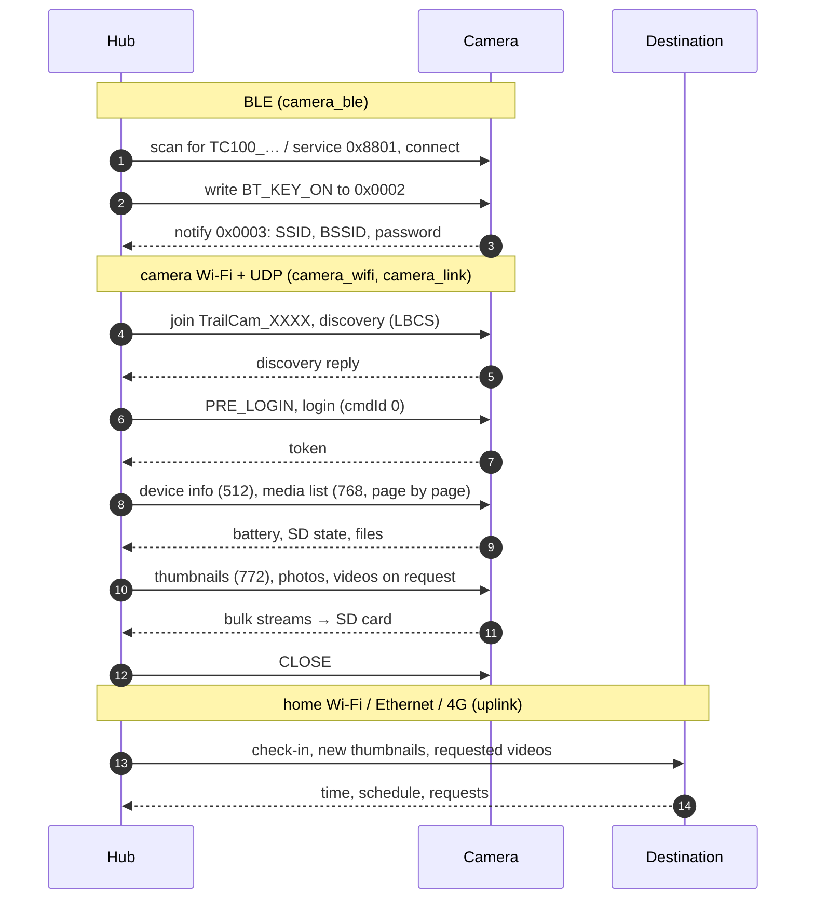
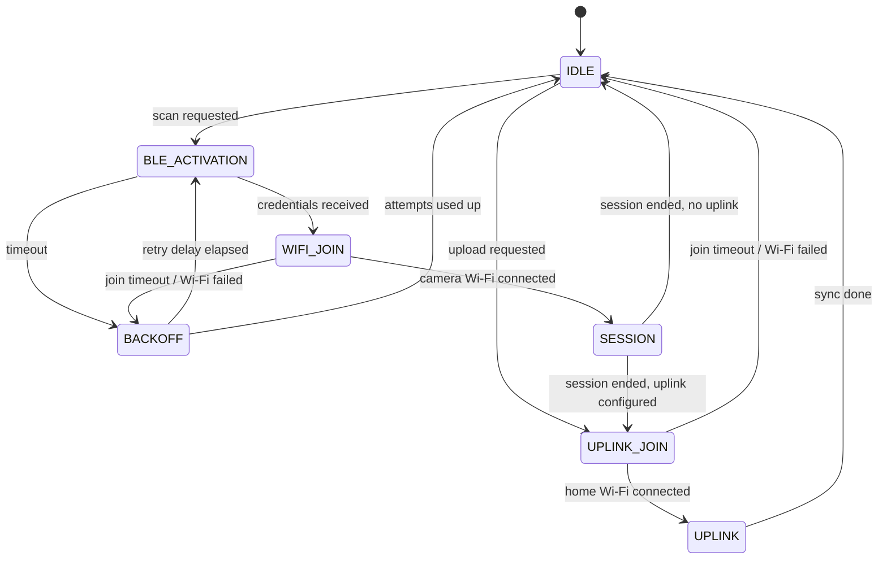

# Architecture

How the firmware is organised: the components, the state machine that runs a
cycle, and the two radio phases (BLE activation, camera session). The wire
format of the camera is in [udp-protocol.md](udp-protocol.md), its encryption
in [protocol-analysis.md](protocol-analysis.md).

## One cycle

## Components

The firmware is split into ESP-IDF components with explicit dependencies.
Code without ESP-IDF headers (parsers, packet builders, state machines,
schedules) sits in separate files and is covered by the host tests in
[`test/host`](../test/host).

| Component | Responsibility |
|---|---|
| `main` | `app_main`: initialises storage and radios and wires the components together |
| `camera_ble` | BLE scan and connection, GATT profile check, Wi-Fi-enable command, credential response |
| `camera_wifi` | Wi-Fi station for the camera access point; runs a session callback after each connection |
| `camera_link` | Camera session over UDP: discovery, PRE_LOGIN, reliable UDP (PPPP), ARTEMIS commands, media list, thumbnails, photos, video playback, media catalog on the SD card |
| `mp4_mux` | Builds MP4 files from the H.264/AAC streams of a video download |
| `sd_storage`, `sd_log` | microSD mount (SDMMC or SPI); log files on the card |
| `session_controller` | Session state machine and the tasks that drive a cycle: camera session, then uplink; request and status interface for front ends |
| `schedule`, `schedule_state`, `scheduler` | Wake-up schedule: camera read plan and check-in times, state across deep sleep, the task that requests cycles and sleeps in between |
| `uplink` | Destinations: own backend (HTTPS check-in, thumbnail upload, acknowledgement), WebDAV, Telegram directly |
| `modem_uplink`, `ethernet_uplink` | A7670E 4G modem over USB/PPP; Ethernet (P4 EMAC, W5500) |
| `hub_config` | Settings in NVS (modes, Wi-Fi, destinations, schedule) with validation and board presets |
| `hub_console` | Line-based serial commands used by the web installer ([installer.md](installer.md#serial-commands)) |
| `web_ui`, `dongle_ui` | Web page on the hub; display and button of the T-Dongles |
| `ota_update`, `coprocessor_update` | Firmware updates from GitHub releases ([ota.md](ota.md)); ESP-Hosted firmware of the P4's C6 |
| `hub_battery`, `time_sync`, `diagnostics` | MAX17048 fuel gauge; which source may set the clock ([clock.md](clock.md)); reset reason, core dump, heap statistics; the cycle trace (cycle number, lowest free heap and stack per cycle, `logs/cycles.jsonl`, see [sd-layout.md](sd-layout.md)) |

## Session state machine

The radio components (`camera_ble`, `camera_wifi`, `camera_link`) and the
uplink do not call each other. They report events through callbacks to the
session controller, which runs them in one task:

A stop request ends the cycle early from any state except `UPLINK`: waking
the camera, joining a Wi-Fi network and the retry delay are left at once; a
running camera session is closed cleanly first; the sync is skipped. A sync
that is already running finishes.

A scan that does not reach the camera is retried a few times (3 attempts,
10 seconds apart by default) and then given up; the hub never retries
forever. Timeouts, attempts and the retry delay are in `menuconfig` under
**Component config → TrailCamHub: session**. The pure state machine (`session_fsm.cpp`) is
host-tested.

### Front ends

The controller does not know who drives it. Front ends request cycles with
`session_controller_request_scan()`, `…_request_upload()` and
`…_request_stop()`, and follow the progress through status listeners
(`session_controller_add_status_listener()`) or by polling
`session_controller_get_status()`: phase, attempt, retry delay, camera SSID
and the result of the last cycle. SSID and result stay set until the next
cycle starts, so a front end can keep showing them.

Front ends are the serial console, the display and button, the web UI, the
Telegram commands and the **scheduler**, which runs cycles on the camera read
plan ([power-and-schedule.md](power-and-schedule.md)).

### Data on the SD card

Each camera keeps its data in `/sdcard/<camera-id>/`: `camera.json` (device
info), `catalog.csv` (which media are known and synced) and `thumb/`, plus
`media/` for photos and videos. A sync covers every camera on the card, so one
hub can serve several cameras. How a file is identified across camera SD
changes is in [media-identity.md](media-identity.md); the file formats are in
[sd-layout.md](sd-layout.md).

## Tasks and who owns what

| Task | Stack | Runs | Owns |
|---|---|---|---|
| `session_ctrl` | 6 KB | the state machine, from one event queue | FSM, cycle settings, the published status (under a lock) |
| `camera_session` | 8 KB | one camera session per request (`camera_protocol_run()`) | all state of `camera_link` during a session; the camera's directory on the SD card |
| `uplink` | 12 KB (TLS) | one sync per request (`uplink::run()`) | the catalogs of all cameras during the sync |
| `scheduler` | 6 KB | requests cycles on the plan, enters deep sleep | the schedule state (RTC memory) |
| `hub_console` | 6 KB | serial commands | nothing shared; calls the request interface |
| `sd_log` | 4 KB | writes the log ring buffer to the card | the log files |
| `sd_writer` | 4 KB | writes downloads to the card (PSRAM boards only) | the open media file |
| `modem` | 4 KB | modem power, registration, PPP | the modem driver |
| `dongle_ui` | 4 KB | display and button | the frame buffer |
| HTTP server | 6 KB | web UI requests | reads the SD card; no session state |

Rules that keep this safe:

- The controller never runs a camera session and a sync at the same time, so
  only one task writes a camera's catalog ([sd-layout.md](sd-layout.md)).
- Other tasks reach the session only through
  `session_controller_request_*()`, the status listeners and the action queue
  ([camera-actions.md](camera-actions.md); `camera_actions` guards it with a
  mutex and keeps it on the SD card). What a session
  reports back (`camera_protocol_stored_items()` and similar) is atomic or
  copied under a lock.
- Callbacks run in the task that reports the event; a front end copies what
  it needs and returns.

## Memory

C++ exceptions are off: an allocation that fails restarts the hub. Buffers
that scale with the data are therefore bounded, and the large ones exist
only with PSRAM. Sizes from the code:

| Buffer | With PSRAM | Without | When |
|---|---|---|---|
| Video reorder window | 256 frames × 1472 B = 377 KB | 8 frames = 12 KB | video download |
| SD writer ring buffer | 4 MB | none (direct writes) | downloads |
| Thumbnail record | one block of the record's size (a few 10 KB, at most `BulkReassembler::kMaxRecordSize`), taken when the record starts; a record the heap cannot hold is skipped | same | one thumbnail at a time; the block is reused during a session and freed after it |
| Catalog | 48 B per recording | same | session, sync (all cameras) |
| Log ring buffer | 64 KB (`SD_LOG_BUFFER_KB`) | same | always |
| Display frame buffer | 160 × 80 × 2 B = 26 KB | same | T-Dongles |

Photos and videos are streamed to the card and never held whole in RAM.
Boards without PSRAM (T-Dongle-S3, WROOM-32D) fetch thumbnails only by
default. The free and minimum heap are logged at fixed stages and with
**Memory log interval**; the console command `heap` (development builds) shows them.

## BLE activation

The hub scans in 30-second windows for a connectable advertisement whose name
starts with `TC100_` or that advertises service `0x8801`, and connects to the
first match not read in this scan yet; other devices nearby are left alone.
After a camera is done, the scan looks for further cameras the same way
([several cameras per scan](power-and-schedule.md#several-cameras-per-scan)).
The name filter is only a fast pre-filter: before anything is written, the
GATT profile must contain service `0x8801` with the writable characteristic
`0x0002` and the notify/indicate characteristic `0x0003`. These UUIDs were
first reported for a Lutranstra PR5000-WF and are confirmed with a TC100.

The hub then subscribes to `0x0003` and writes the Wi-Fi-enable command,
ASCII `BT_KEY_ON` (`42 54 5F 4B 45 59 5F 4F 4E`) by default (**Wi-Fi enable
payload (hex)** in `menuconfig`; empty = only inspect the GATT profile). The
camera answers with a framed JSON response (`13 57 01 00`, length, JSON with
`ssid`, `bssid` and `pwd`) in several notifications, which the hub
reassembles.

`camera_ble` uses NimBLE as a central/GATT client only (no pairing, one
connection). `camera_ble.cpp` owns the stack lifecycle, scanning, the
connection and the GATT sequence (services → characteristics → CCCD →
write); `camera_ble_discovery.cpp` filters advertisements and
`camera_ble_protocol.cpp` parses the response. The stack and the controller
run only while a camera is being activated; with **Release BLE after the
camera Wi-Fi was activated** (default) the hub disconnects and shuts BLE down
once the credentials have arrived, which frees the memory for the camera
session. Disable it if a camera turns its access point off when the BLE
connection ends.

The log shows the camera's address, RSSI, advertisement, services and
characteristics, and the SSID and BSSID of the response. The Wi-Fi password
is never logged; credentials stay in RAM and are not stored. The SSID
(`TrailCam_897B`) cannot be predicted from the BLE name.

## Camera session

`camera_wifi` joins the camera's access point with the credentials from BLE.
`camera_link` then runs the session over UDP (local port `35281`):

- **Discovery and PRE_LOGIN** — an `LBCS` probe to the gateway on ports
  `40611` and `3333`; the reply's source port is the camera's. PRE_LOGIN
  (`F9`, AES-128-ECB, current time and a nonce) can be turned off
  (`CONFIG_CAMERA_SEND_PRELOGIN`); the app itself never sends it to the
  camera ([#51](https://github.com/ThomasPohl/TrailCamHub/issues/51)).
- **Reliable UDP** (`pppp_session.cpp`) — DATA packets (`F1 D0`) numbered per
  channel from 0, ACKs (`F1 D1`) listing the received indices, retransmission
  of unacknowledged DATA after 800 ms, duplicate filtering, ALIVE answers
  (`F1 E0` → `F1 E1`, without them the camera closes the session) and CLOSE
  (`F1 F0`).
- **ARTEMIS commands** on channel 0 — JSON, AES-128-CBC encrypted and
  Base64-encoded behind an `ARTEMIS\0` header: login (cmdId 0, returns the
  token), device info (512), media list (768, 45 entries per page),
  thumbnails (772), photo download, video playback, heartbeats (525) every
  1.5 s.
- **Bulk streams** on the other channels carry thumbnails, photos and video
  frames; they are reassembled, reordered and written to the SD card while
  they arrive ([video-download.md](video-download.md)).

Times from the camera are its wall clock, not UTC ([clock.md](clock.md)).
With **Log camera UDP packet contents as hex** (default on in the development
build) every packet is logged in hex; credentials never are.

## Reliability and security principles

- Mark files as present only after a complete download; uploads are
  idempotent and resume after power or network failures.
- Store credentials only on the device (NVS), never in logs; passwords and
  keys are written by the installer but never read back.
- Encrypt connections to destinations and validate certificates.
- Bound SD usage; errors and diagnostics must be useful on a device without
  a screen (log files on the SD card, support package in the installer).
