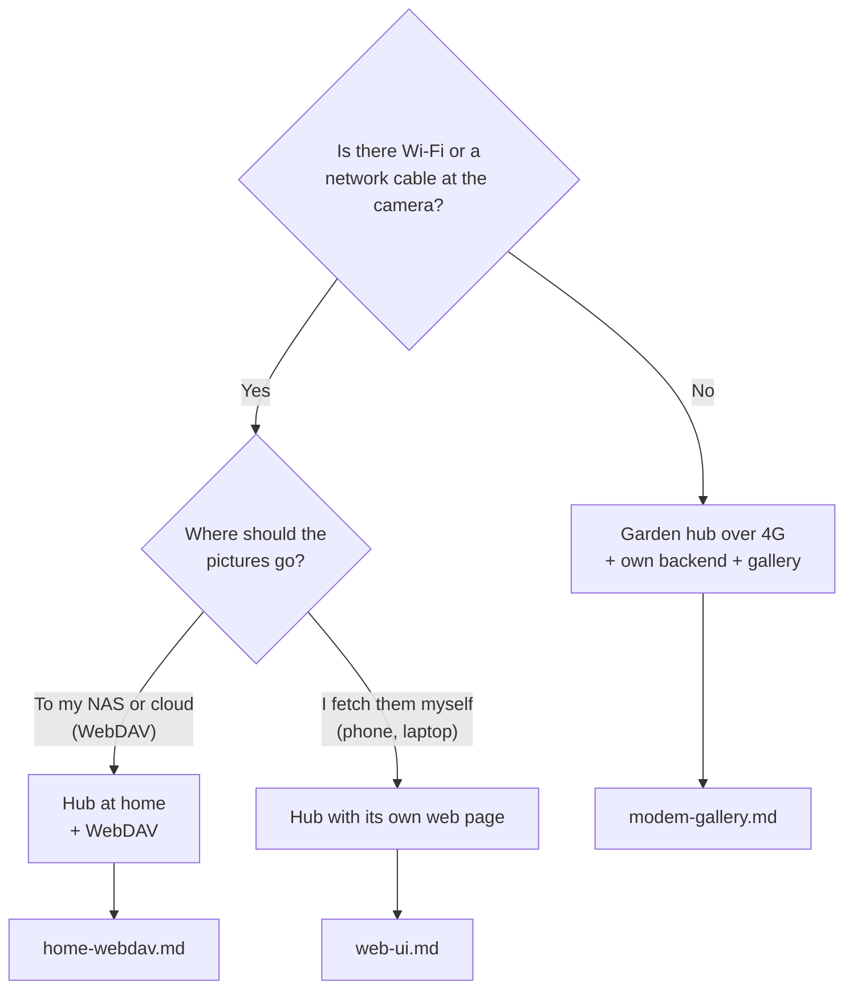

# Guide: build your own hub

For people who want a TrailCamHub without reading the code. Pick a path, buy
the parts, follow one guide. Everything runs without a server of the
project's; the only running costs are a SIM plan (4G) and, if you use AWS,
cents for storage.

## What do you want to achieve?

The diagram is drawn where Markdown diagrams are shown, for example
[on GitHub](https://github.com/ThomasPohl/TrailCamHub/blob/main/docs/guide/README.md#what-do-you-want-to-achieve);
the table below says the same.

| I want … | Mode | Guide | Parts |
| --- | --- | --- | --- |
| Pictures from a camera far from any Wi-Fi, looked at on a laptop or phone | 4G modem + own backend + gallery | [modem-gallery.md](modem-gallery.md) | [shopping list A](shopping-list.md#a-garden-hub-over-4g-modem--own-backend--gallery) |
| Pictures from a camera at home, saved on my NAS | home Wi-Fi + WebDAV | [home-webdav.md](home-webdav.md) | [shopping list B](shopping-list.md#b-hub-at-home-with-a-nas-home-wi-fi--webdav) |
| To fetch pictures when I am there, or on a wired network | web page on the hub (pull) | [web-ui.md](web-ui.md) | [shopping list C](shopping-list.md#c-hub-with-its-own-web-page-pull-dongle-or-ethernet-board) |

## I already have a board

| Board | Fits best | Note |
| --- | --- | --- |
| Waveshare ESP32-S3-A7670E-4G | [4G + gallery](modem-gallery.md); also home Wi-Fi + WebDAV | the main, best tested board |
| LilyGO T-Dongle-C5 | [web page](web-ui.md) | display, button, own access point; [operating it](dongle.md) |
| LilyGO T-Dongle-S3 | [web page](web-ui.md) | no PSRAM; not tested on hardware; [operating it](dongle.md) |
| Waveshare ESP32-S3-ETH, ESP32-P4-NANO | [web page](web-ui.md) over Ethernet; [WebDAV](home-webdav.md) | wired network |
| ESP32-WROOM-32D with an SPI microSD reader | [WebDAV](home-webdav.md); [wiring](../wiring-wroom32d.md) | little memory (#244) |

Capabilities of every board: [hardware.md](../hardware.md) and
[`boards.json`](../../boards.json).

## More

- [Shopping list per mode](shopping-list.md)
- [Camera compatibility](compatibility.md) and how to report a new camera
- [Troubleshooting by symptom](troubleshooting.md), with a short privacy note
- [Modes in detail](../modes.md), [web installer](../installer.md),
  [power and schedule](../power-and-schedule.md)
- Questions and ideas: open an [issue](https://github.com/ThomasPohl/TrailCamHub/issues/new/choose)
