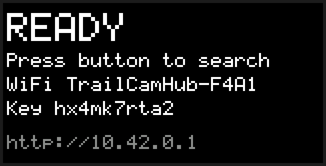
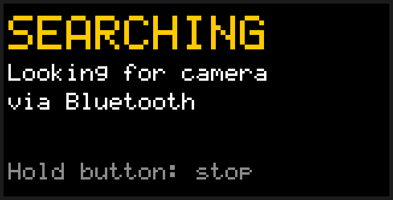
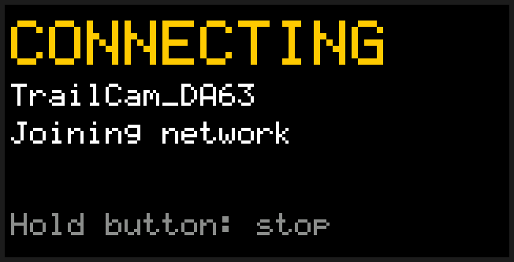
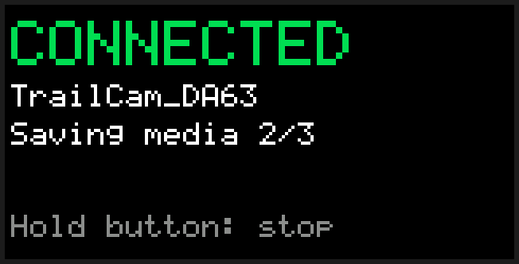
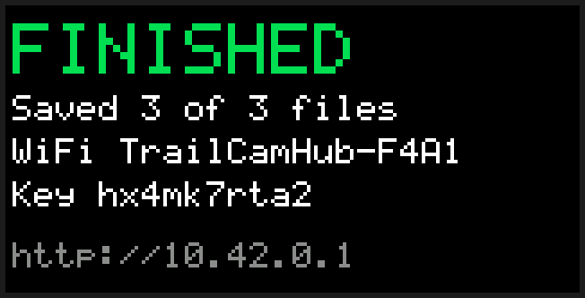
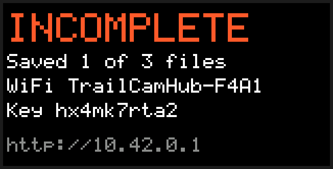
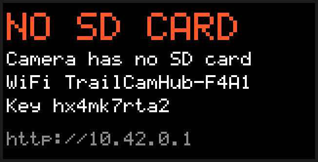
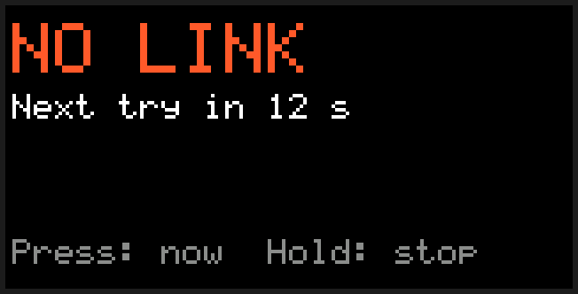

# Operating a dongle

The LilyGO T-Dongles (C5 and S3) have a small colour display, one button and
an RGB LED. This page explains what they show and what the button does. To set
one up, follow the [web page guide](web-ui.md).

## The button

| Press | What happens |
| --- | --- |
| Short press | Search for the camera now: the hub wakes it over Bluetooth, joins its Wi-Fi and reads it. While the hub waits to try again (screen *NO LINK*), a short press tries at once. |
| Hold for about 1.5 s | Stop the running search or session. |

The button does nothing else. Settings, the schedule and deleting go through
the hub's [web page](web-ui.md) (or the installer over USB).

## The LED

| Colour | Means |
| --- | --- |
| White | Ready, or stopped; nothing is running. |
| Amber | Busy: searching for the camera or joining its Wi-Fi. |
| Green | Connected to the camera, or the last search ended well. |
| Red-orange | The last search needs a look: camera not found, no SD card, incomplete, no upload, or waiting to retry. |

## The screens

When the hub runs its own access point (dongle default), the lower lines of
the ready and result screens show how to reach its web page:

- `WiFi TrailCamHub-XXXX`: the network to join with a phone or laptop;
- `Key …`: its WPA2 password;
- the address at the bottom, usually `http://10.42.0.1`.

The page itself asks for no further password. Without an access point the
lower lines say "Press button to search again".

| Screen | What it means | What to do |
| --- | --- | --- |
|  **READY** | Started, nothing running. | Press the button, or use *Start* on the web page. |
|  **SEARCHING** | Looking for the camera over Bluetooth. | Wait; hold the button to stop. |
|  **CONNECTING** | The camera answered; the hub joins the camera's Wi-Fi (its name on the first line). | Wait. |
|  **CONNECTED** | Reading the camera: "Saving media 3/10" while files come in. | Wait; hold the button to stop. |
|  **FINISHED** | Done: "Saved 3 of 3 files", or "Camera synced" when there was nothing new. | Open the web page to look at the pictures. |
|  **LISTED** | The hub read the list of files on the camera without downloading them. | Nothing; download from the web page if you want them. |
|  **INCOMPLETE** | The session ended early: "Saved 2 of 5 files" or "Session ended early". | Press again. If it keeps happening, move the hub closer to the camera. |
|  **NOT FOUND** | The camera did not answer over Bluetooth or Wi-Fi. | Check that the camera is switched on and in range, then press again. See [troubleshooting](troubleshooting.md). |
|  **NO SD CARD** | The camera has no SD card (or cannot read it). | Insert or replace the camera's card. |
|  **NO UPLOAD** | The pictures are on the hub, but the home Wi-Fi was not reached (only with `transport wifi`). | Check the home Wi-Fi; the next search uploads again. |
|  **STOPPED** | You held the button (or pressed *Stop*). | Press to search again. |
|  **NO LINK** | The connection to the camera failed; "Next try in … s" counts down to the next attempt. | Wait, press for a try now, or hold to stop. |

The pictures are drawn by the firmware's own renderer
(`components/dongle_ui`), so they match the real display; CI checks that they
are up to date.

If something does not work, see [troubleshooting](troubleshooting.md).
