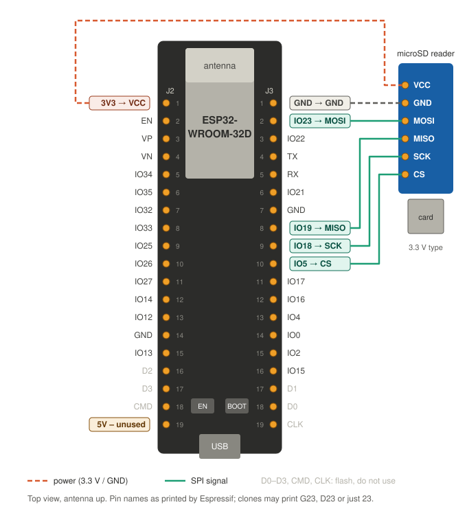
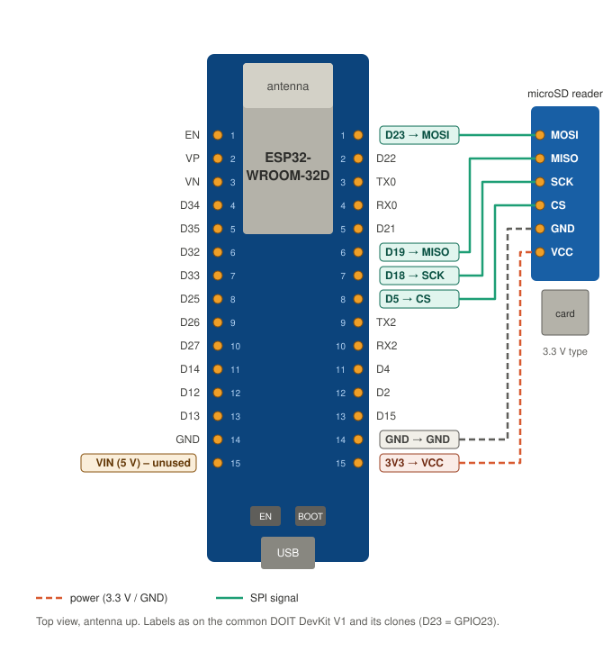

# Wiring the ESP32-WROOM-32D board

This page shows how to connect a microSD reader to an ESP32 dev board with a
WROOM-32D module, image `wroom32d` (#77). Board notes and limits (no PSRAM,
thumbnails only, mains power) are in [modes.md](modes.md#esp32-wroom-32d-with-an-spi-microsd-reader).

## What you need

- An ESP32 dev board with an ESP32-WROOM-32D or -32E module. Count its pins:
  - **38 pins** (two rows of 19): ESP32-DevKitC V4 or a clone, see
    [38-pin board](#38-pin-board-esp32-devkitc-v4).
  - **30 pins** (two rows of 15): "ESP32 DevKit V1", DOIT or a clone, see
    [30-pin board](#30-pin-board-esp32-devkit-v1).

  The GPIO numbers are the same on both; only their place on the board
  differs. If your board looks different from both drawings, follow the
  labels printed on it.
- A **microSD reader breakout** with SPI pins (VCC, GND, MISO, MOSI, SCK, CS).
- Six female-to-female jumper wires, as short as possible (under 10 cm).
- A microSD card, FAT32, up to 32 GB (SDHC).

## Which supply voltage?

Check the reader before you wire it. There are two common kinds:

| Reader | How to recognise it | VCC goes to |
| ------ | ------------------- | ----------- |
| 3.3 V reader | no regulator, often marked "3.3V" | **3V3** |
| 5 V reader | blue board with an AMS1117 regulator and a 74LVC125A chip, often marked "4.5–5.5 V" | **5V** (38 pins) or **VIN** (30 pins) |

A 3.3 V reader on 5V or VIN can destroy the card. A 5 V reader on 3V3 gets
too little voltage after its regulator and fails to mount the card.

## 38-pin board (ESP32-DevKitC V4)

Hold the board with the antenna up and the components facing you. J2 is the
left row, J3 the right row; pin 1 of each row is next to the antenna.

| Reader | Board pin | Row / position | Firmware setting |
| ------ | --------- | -------------- | ---------------- |
| VCC    | 3V3       | J2 / 1         | |
| GND    | GND       | J3 / 1         | |
| MOSI   | IO23      | J3 / 2         | `CONFIG_SD_CARD_CMD_GPIO` |
| MISO   | IO19      | J3 / 8         | `CONFIG_SD_CARD_D0_GPIO` |
| SCK    | IO18      | J3 / 9         | `CONFIG_SD_CARD_CLK_GPIO` |
| CS     | IO5       | J3 / 10        | `CONFIG_SD_CARD_CS_GPIO` |

For a **5 V reader** the only change is VCC: connect it to **5V** (J2 / 19)
instead of 3V3. The signal lines stay the same.

Any GND pin works (J2 / 14, J3 / 1, J3 / 7); J3 / 1 keeps all six wires
close together.

## 30-pin board (ESP32 DevKit V1)

Hold the board with the antenna up and the components facing you. Count the
pins of each row from the antenna end (1) down to the USB end (15). All six
wires go to the right row. These boards print the GPIO number with a `D`:
`D23` is GPIO23.

| Reader | Board pin | Right row, position | Firmware setting |
| ------ | --------- | ------------------- | ---------------- |
| MOSI   | D23       | 1                   | `CONFIG_SD_CARD_CMD_GPIO` |
| MISO   | D19       | 6                   | `CONFIG_SD_CARD_D0_GPIO` |
| SCK    | D18       | 7                   | `CONFIG_SD_CARD_CLK_GPIO` |
| CS     | D5        | 8                   | `CONFIG_SD_CARD_CS_GPIO` |
| GND    | GND       | 14                  | |
| VCC    | 3V3       | 15                  | |

For a **5 V reader** connect VCC to **VIN** (left row, position 15) instead
of 3V3.

The 30-pin board does not bring out the flash pins (D0–D3, CMD, CLK), so
there is nothing to avoid there.

## Pins to leave alone

This applies only if you add more hardware; the reader uses none of these.

- **D0–D3, CMD, CLK** (38-pin board only, bottom of both rows, near USB):
  connected to the module's flash. Using them crashes the board.
- **GPIO 0, 2, 12, 15**: strapping pins that decide how the chip boots.
  GPIO5 is one too, but it must be high at boot, which the reader's CS
  pull-up ensures.
- **GPIO 34, 35, VP, VN**: inputs only.
- **TX/RX** (TX0/RX0 on the 30-pin board): the console over USB.

## Check it

1. Insert the card, then plug in USB. Do not feed 5V/VIN or 3V3 from
   another supply at the same time.
2. Flash the `wroom32d` image with the [installer](installer.md).
3. The boot log first prints `Mounting SD card (SPI, SCK=18 MOSI=23 MISO=19
   CS=5)` and then `SD card mounted at /sdcard: … MB total, … MB free`.
   If it reports `Could not initialize SD card` instead:
   - check VCC against the table above,
   - swap MISO and MOSI if they are mixed up (the reader may label them
     DO/DI: DO = MISO, DI = MOSI),
   - shorten the wires.

   `SD card found, but its file system could not be mounted` means the
   wiring works: format the card as FAT32 on a computer.

Pin positions of the 38-pin board follow the header tables in Espressif's
[ESP32-DevKitC V4 user guide](https://docs.espressif.com/projects/esp-dev-kits/en/latest/esp32/esp32-devkitc/user_guide.html).
The 30-pin board has no Espressif documentation; its order follows the
common DOIT DevKit V1 layout (for example the
[espboards.dev page](https://www.espboards.dev/esp32/esp32doit-devkit-v1/)).
